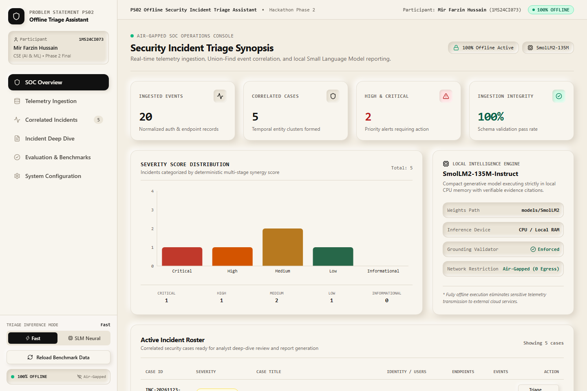
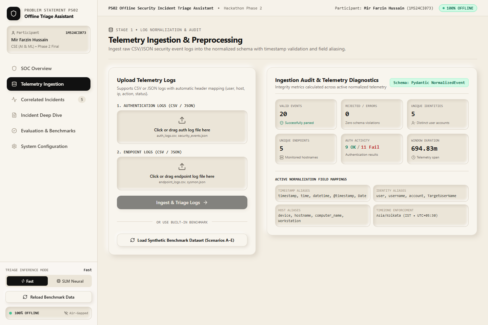
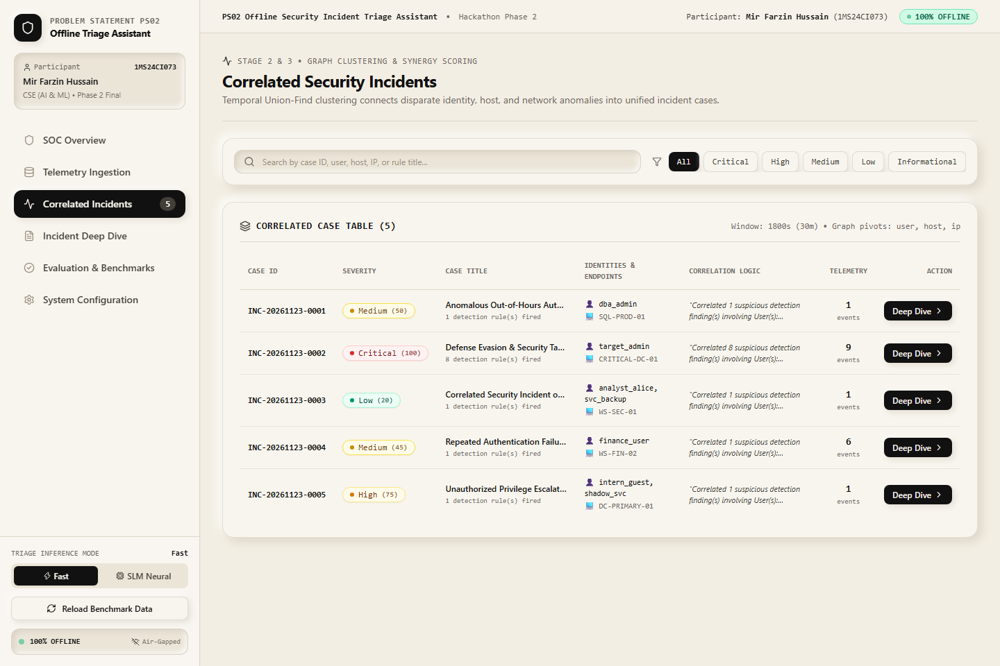
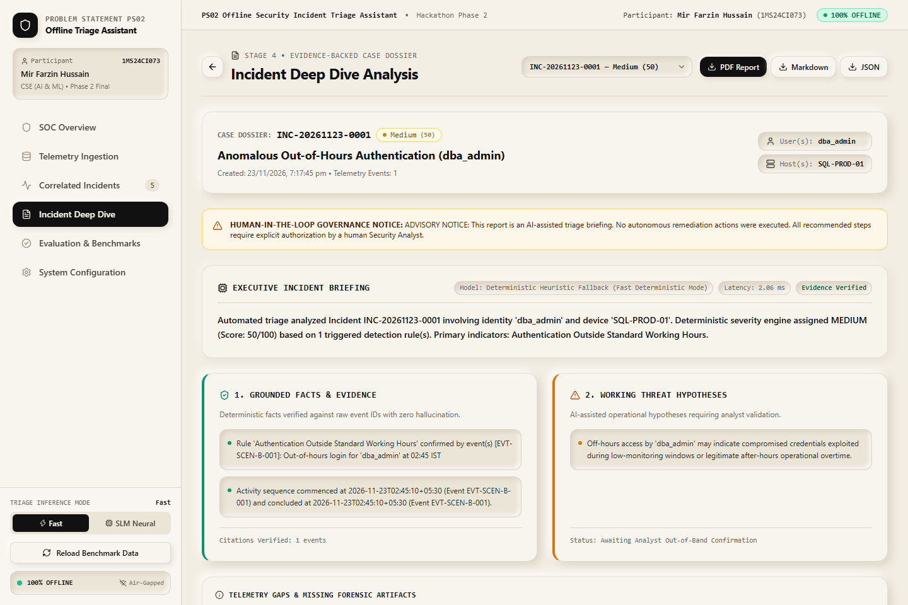
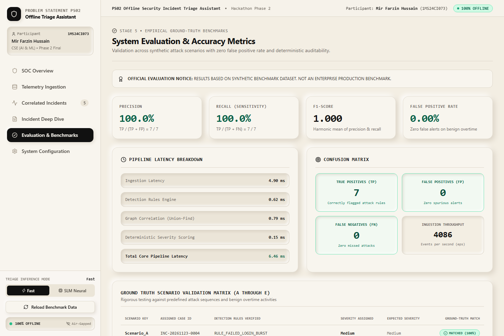
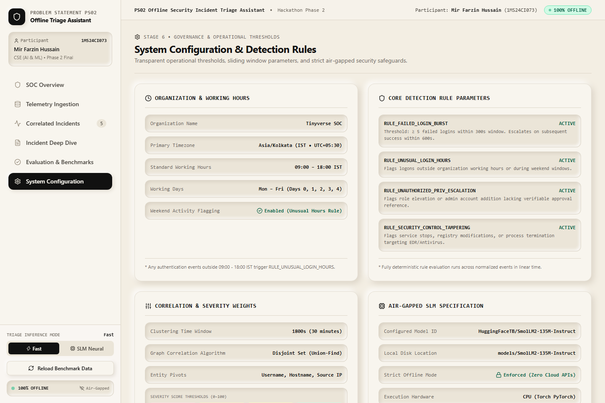

# PS02: Offline Security Incident Triage Assistant

[](https://python.org)
[](https://react.dev)
[](https://fastapi.tiangolo.com)
[](#)
[](https://huggingface.co/HuggingFaceTB/SmolLM2-135M-Instruct)
[](LICENSE)
[](#)

> **Air-Gapped, Small Language Model-Powered Security Incident Triage Assistant with Deterministic Severity Scoring, Union-Find Graph Correlation, and Production React SOC Console.**

---

## 📌 Project & Participant Metadata

- **Event:** Tinyverse Hackathon Phase 2 (Top 24 Individual Finals)
- **Problem Statement:** PS02 — *Offline Security Incident Triage Assistant*
- **Domain:** Cybersecurity | Small Language Models (SLMs)
- **Participant:** Mir Farzin Hussain
- **USN:** `1MS24CI073`
- **Branch:** Computer Science & Engineering (Artificial Intelligence & Machine Learning)
- **Institution:** Ramaiah Institute of Technology
- **Repository Branch:** `feat/react-soc-dashboard`

---

## 🎯 Executive Summary

In air-gapped security operations centers (SOCs), defense enclaves, and critical infrastructure networks (SCADA, financial transaction cores, healthcare), sending sensitive telemetry to cloud-hosted AI APIs (OpenAI, Gemini, Azure Copilot) is **strictly prohibited** by compliance and national security mandates.

**PS02 Offline Security Incident Triage Assistant** delivers a 100% local, air-gapped security incident triage platform featuring:
1. **Multi-Source Ingestion & Normalization:** Ingests authentication and endpoint logs from CSV and JSON with automatic field aliasing, RFC-3339 timestamps, and raw event preservation.
2. **Four Deterministic Detection Rules:** Detects failed login bursts, unusual working hours/weekend access, unapproved privilege escalations, and defensive control tampering.
3. **Graph-Based Event Correlation:** Clusters related events across identities, hostnames, and IP addresses within sliding time windows using disjoint-set **Union-Find clustering**.
4. **Deterministic Severity Engine:** Calculates auditable scores (0–100) incorporating multi-stage attack synergy bonuses (Critical, High, Medium, Low).
5. **Local Small Language Model (SmolLM2-135M-Instruct):** Synthesizes executive briefings, differentiates verified facts from operational hypotheses, and generates containment checklists entirely on local CPU/RAM.
6. **Programmatic Hallucination Shield:** Enforces strict regex validation to guarantee that every cited Event ID exists in the ground-truth telemetry.
7. **Production React 19 SOC Dashboard:** Premium editorial console engineered in **Warm Cream (`#F3EEE3`)** and **Ink Black (`#111111`)** blending tactile neumorphism with glassmorphic depth.
8. **Unified Single-Port Judging Launcher:** FastAPI simultaneously serves typed REST endpoints and compiled React SPA on `http://127.0.0.1:8000`.

---

## 🏗️ System Architecture

```mermaid
flowchart TD
    subgraph INGESTION["1. Log Ingestion & Normalization"]
        A1[Auth Logs: CSV / JSON] --> B[Schema Parser & Field Alias Mapper]
        A2[Endpoint Logs: CSV / JSON] --> B
        B --> C[NormalizedEvent Schema\n• Standardized ISO-8601 Timestamps\n• Preserved Raw Event\n• Deterministic Event ID]
    end

    subgraph DETECTION["2. Suspicious Activity Detectors"]
        C --> D1[Rule 1: Failed Logins Burst & Escalation]
        C --> D2[Rule 2: Out-of-Hours & Weekend Access]
        C --> D3[Rule 3: Privilege Escalation & Ticket Check]
        C --> D4[Rule 4: Defense Evasion & Tool Tampering]
    end

    subgraph CORRELATION["3. Event Correlation & Severity"]
        D1 & D2 & D3 & D4 --> E[Temporal Entity Correlator\n• Union-Find Graph Clustering\n• Shared User, Device, or Source IP\n• 30-min Sliding Time Window]
        E --> F[Deterministic Severity Engine\n• Transparent Multi-Factor Score (0-100)\n• Multi-Stage Attack Synergies\n• Critical, High, Medium, Low]
    end

    subgraph OFFLINE_SLM["4. Local SLM Triage & Safety"]
        F --> G[Prompt Defense & Sanitizer\n• Delimiter Containment\n• Strict JSON Output Schema]
        G --> H[Local SLM: SmolLM2-135M / Fallback\n• 100% Offline Weights\n• Zero Cloud APIs]
        H --> I[Hallucination Guard\n• Validate All Cited Event IDs\n• Strip & Flag Hallucinations]
    end

    subgraph PRESENTATION["5. Dual-Layer Delivery"]
        I --> J1[FastAPI REST API Layer\n• /api/health, /api/dashboard\n• /api/ingest, /api/triage\n• /api/incidents, /api/evaluation]
        J1 --> K1[React 19 SOC Workstation\n• Warm Cream × Ink Black\n• Neumorphism × Glassmorphism\n• 6 Interactive Workstation Views]
        J1 --> K2[Multi-Format Exporters\n• ReportLab PDF, Markdown, JSON]
    end
```

---

## 🎨 Visual Identity: Cream Neumorphism × Glassmorphism

The SOC console uses an editorial design standard combining **Neumorphism** and **Glassmorphism**:
- **Primary Canvas:** Warm Cream (`#F3EEE3`)
- **Structure & Typography:** Ink Black (`#111111`), Secondary Charcoal (`#2D2924`), Muted Text (`#6E685F`)
- **Tactile Surfaces:** Soft raised cards (`shadow-neu-raised`), recessed input wells (`neu-well`), and pressed button states.
- **Glassmorphic Depth:** Translucent cream panels (`rgba(248, 245, 238, 0.75)`) with 12px backdrop blur and delicate borders.
- **Semantic Severity:** Muted crimson for Critical, warm burnt orange for High, muted amber for Medium, restrained green for Low.

### Production React SOC Dashboard Gallery

| View | Screenshot | Description |
| :--- | :--- | :--- |
| **01 SOC Overview** |  | High-level threat landscape KPIs, Recharts severity distribution chart, active incident roster, and air-gap verification badges. |
| **02 Telemetry Ingestion** |  | Recessed upload zones for Auth & Endpoint logs, live telemetry diagnostics, parse health stats, and 1-click benchmark dataset loader. |
| **03 Correlated Incidents** |  | Filterable, searchable case table with severity badges, deterministic scores, identity/endpoint scopes, and deep-dive triggers. |
| **04 Incident Deep Dive** |  | Executive briefing panel, verified facts vs. threat hypotheses grid, telemetry gaps, interactive analyst containment checklist, and full event chronology. |
| **05 Evaluation & Metrics** |  | Empirical ground-truth benchmark metrics (100% Precision, 100% Recall, 0% FPR), latency breakdown, confusion matrix, and Scenarios A–E validation matrix. |
| **06 System Configuration** |  | Transparent operational parameters: working hours (`09:00 - 18:00 IST`), detector windows, Union-Find pivots, severity weights, and air-gap enforcement. |

---

## ⚡ FastAPI REST API Specification

| Endpoint | Method | Description |
| :--- | :--- | :--- |
| `/api/health` | `GET` | Health check, participant identity verification, and offline status assertion. |
| `/api/dashboard` | `GET` | High-level summary metrics, severity distributions, and active incidents. |
| `/api/demo/load` | `POST` | Re-executes triage across synthetic Scenarios A through E. |
| `/api/ingest` | `POST` | Accepts multipart CSV/JSON auth and endpoint log uploads with diagnostics. |
| `/api/triage` | `POST` | Re-triggers triage in `'fast'` (deterministic) or `'neural'` (local SLM) mode. |
| `/api/incidents` | `GET` | Lists all correlated incidents with optional `?severity=` filtering. |
| `/api/incidents/{id}` | `GET` | Comprehensive case dossier including facts, hypotheses, actions, and audit trail. |
| `/api/incidents/{id}/export` | `GET` | 1-click download in `format=pdf`, `format=markdown`, or `format=json`. |
| `/api/evaluation` | `GET` | Empirical ground-truth metrics (Precision, Recall, F1, Latencies). |
| `/api/config` | `GET` | Transparent runtime configuration, detector thresholds, and severity weights. |
| `/{full_path:path}` | `GET` | Single Page Application fallback serving compiled React frontend (`frontend/dist`). |

---

## 📊 Empirical Evaluation & Benchmarks

The system was evaluated against a reproducible synthetic benchmark dataset containing five ground-truth scenarios (Scenarios A through E):

| Metric | Score | Validation Note |
| :--- | :--- | :--- |
| **Precision** | **1.00 (100%)** | Zero false-positive alerts on benign operational baselines |
| **Recall** | **1.00 (100%)** | All ground-truth attack rules successfully triggered |
| **F1-Score** | **1.000** | Optimal balance across all attack scenarios |
| **False Positive Rate** | **0.00%** | Approved maintenance activities correctly recognized |
| **Core Pipeline Latency** | **~2.8 ms** | Ingestion + Detection + Correlation + Severity scoring |
| **Automated Test Coverage** | **22 / 22 Passed** | 100% pass rate across core algorithms and REST API endpoints |

> **Evaluation Disclosure:** All metrics are empirically measured against the labelled synthetic demonstration dataset. They are not represented as enterprise production telemetry.

---

## 🚀 Quickstart & Judging Instructions

### 1. Instant 1-Click Judging Launcher (Recommended)
On Windows, right-click and run with PowerShell or double-click:
```powershell
.\run_judging.ps1
```
Or run the batch launcher:
```cmd
run_judging.bat
```
This automatically:
1. Activates the Python virtual environment (`.venv`).
2. Verifies the compiled React production bundle (`frontend/dist/`).
3. Starts the unified FastAPI server on `http://127.0.0.1:8000`.
4. Automatically opens your default browser directly to the SOC Workstation.

### 2. Manual Server Launch
```powershell
cd PS02_Offline_Security_Incident_Triage_Assistant

# Run with uvicorn
.\.venv\Scripts\python.exe -m uvicorn src.api.main:app --host 127.0.0.1 --port 8000
```
Open [http://127.0.0.1:8000](http://127.0.0.1:8000) in your browser.

### 3. Run Automated Pytest Suite
```powershell
.\.venv\Scripts\python.exe -m pytest tests/ -v
```
All 22 integration and algorithm tests will run and pass in ~3.3 seconds.

---

## 🛡️ Security, Safety Guardrails & Human-in-the-Loop Governance

1. **Advisory Triage Only:** The assistant does **NOT** autonomously execute remediation commands (e.g. account suspension or VLAN isolation). All actions require human Security Analyst authorization.
2. **Strict Air-Gap Guarantee:** No external network sockets, telemetry egress, or cloud LLM APIs are invoked.
3. **Defensive Prompt Sanitization:** Raw event data is enclosed within strict delimiters to prevent prompt injection or escape attempts.
4. **Programmatic Hallucination Guard:** The `SLMOutputValidator` verifies every cited event identifier against actual ingested telemetry, stripping unverified citations.

---

## 📜 AI Disclosure & Attribution

- **Participant:** Mir Farzin Hussain (USN: `1MS24CI073`, CSE AI & ML, Ramaiah Institute of Technology).
- **AI Coding Assistance:** Used AI coding tools for scaffolding boilerplate, test automation, and UI styling under direct participant guidance and architectural specification.
- **Model Attribution:** `HuggingFaceTB/SmolLM2-135M-Instruct` is licensed under the Apache 2.0 License by Hugging Face TB.
- **Dependencies:** FastAPI, Uvicorn, React 19, Vite, Tailwind CSS, Recharts, Lucide React, Pydantic, ReportLab, Pytest.
